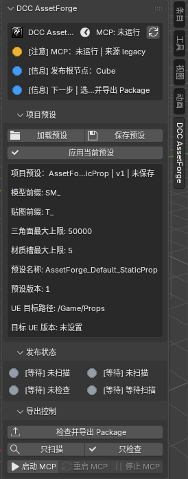
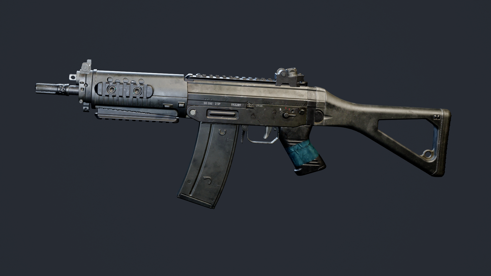

<h1 align="center">DCC AssetForge</h1>

<strong>从 Maya / Blender 到 Unreal Editor 的静态道具发布与验收工具</strong> 导出前检查资产，进 UE 前核对写入，入库后复验。

<strong>简体中文</strong> · <a href="README.en.md">English</a>

<a href="https://github.com/Elviszhuoyu/DCC-AssetForge/releases/download/v0.2.0/DCC-AssetForge-v0.2.0-Win64.zip"><strong>下载 v0.2.0 · Windows 64 位</strong></a> · <a href="#快速开始">快速开始</a> · <a href="#工具界面">工具界面</a> · <a href="#兼容范围">兼容范围</a>

## 为什么做 DCC AssetForge

命名混乱、贴图通道错配，常常到进 UE 才被发现。美术需要回到 DCC 修正后重导，验收同事还要重新查模型、贴图和材质。AssetForge 把**项目规则、材质绑定和检查结果随包交接**，方便制作者和验收者核对同一份记录。

- **按团队规范发布。** 共用 JSON 项目预设，统一命名、网格预算、目标目录和贴图规则。导出前检查，发现问题可以直接定位。
- **先核对，再写入 UE。** 识别 Substance 3D Painter 的 PBR/ARM 贴图，检查材质槽和写入目标，按策略增量复用兼容的材质实例和贴图。
- **导入后有记录可复验。** 对网格、贴图和材质执行批审，保留问题与返修结果，再到 UE 视口确认最终外观。

## 工具界面

### Unreal Editor · 包体导入

选中包体后，在写入前核对目标目录、材质槽和贴图。导入完成后，从回执直接进入本次入库批审。

本次 SG552 导入 1 个网格、21 张贴图和 7 个材质实例。回执记录 0 项阻断。

### Maya · 资产检查与贴图匹配

点击检查结果可定位问题组件。发布设置可按材质槽检查贴图，核对基础色、法线和 ARM/ORM 的匹配数量。

  
  

[查看 Maya 1920×1080 检查原图](docs/images/maya-workbench.png) · [查看 1920×1080 贴图匹配原图](docs/images/maya-texture-settings.png)

### Unreal Editor · 入库批审

按项目规则检查网格、材质槽和贴图，定位问题，并对照每一轮复验结果。

这次演示将本批次的材质槽上限设为 8。SG552 实际使用 7 槽，复验结果为 117 项通过、0 项问题。

### Blender · 基础导出（Beta）

在 3D 视图按 <kbd>N</kbd>，打开「DCC AssetForge」侧栏，扫描、检查并导出静态道具。

[查看 Blender 宿主原图](docs/images/blender-export-beta.png)

### SG552 · Unreal 实机渲染

## 快速开始

### Windows 安装助手

1. 下载顶部的 Windows ZIP，完整解压到**纯英文、无空格**的本地文件夹，保留 `Payload` 文件夹。
2. 双击根目录的 **DCC-AssetForge-Setup.exe**，选择宿主、版本和安装位置，再点「安装」。
3. 如果 UE 已使用引擎级安装，在新工程的「编辑 → 插件」启用 **DCC AssetForge**。需要按项目隔离插件版本时，选择工程级安装。

Windows 如果提示 SmartScreen，确认来自官方 Release 后，点「更多信息」→「仍要运行」。[安装、手动安装与卸载指南](安装指南.md) · [下载 SHA-256 校验文件](https://github.com/Elviszhuoyu/DCC-AssetForge/releases/download/v0.2.0/DCC-AssetForge-v0.2.0-Win64.zip.sha256)

### 从导出走到入库

1. **Maya 检查并导出。** 选中道具，在「AssetForge」工具架点 **AF**，依次点「检查资产」和「检查并导出 Package」。Blender 使用 N 侧栏的导出入口。
2. **UE 核对并导入。** 点工具栏 **AF**，选择包体，点「检查包体」。核对写入目标后点「确认导入」。
3. **检查入库结果。** 从成功回执进入「入库批审」，确认网格、材质槽和贴图，再到 UE 视口检查外观。

## 兼容范围

| 宿主 | 当前支持 | 本机验证 |
| --- | --- | --- |
| Maya 2022–2026 | Python 3，2022–2024 使用 PySide2，2025–2026 使用 PySide6 | Maya 2024.2 验证了拖放安装、工作台和贴图样例。其他版本按标准接口兼容，未逐版实测。 |
| UE 5.8.4 / 5.6.1 Win64 | 两版提供对应构建的预编译插件 | UE 5.8.4 已走通引擎级安装后的真实导入和批审。UE 5.6.1 已验证候选版工程级安装、工作台和内置资源加载。 |
| UE 5.3–5.8 其他构建 | 可选工程级源码安装，需要兼容的 Visual Studio C++ 编译工具和 Windows SDK | 没有逐版本实测。UE 5.3–5.5 可能无法读取用 UE 5.6.1 保存的随包资源。 |
| Blender 4.2 LTS 起 | 基础导出（Beta） | Blender 5.2.1 LTS 已验证安装、打开侧栏和卸载。 |
| 3ds Max | 暂不支持 | — |

## 文档与许可

[中文版使用手册](README.zh-CN.md) · [English guide](README.en.md) · [v0.2.0 发布说明](RELEASE_NOTES.md) · [反馈问题](https://github.com/Elviszhuoyu/DCC-AssetForge/issues)

开发者 **卓雨 / Elviszhuoyu**。代码与文档采用 **MIT License**，品牌素材的使用范围另有说明。[作者主页](https://work.zhuoyulabs.com) · [MIT License](LICENSE) · [品牌素材许可](BRAND_ASSET_POLICY.md)
