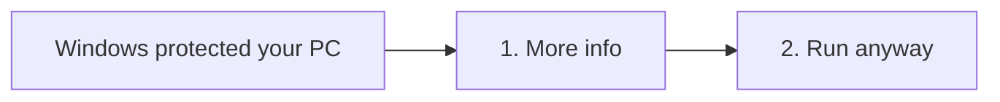
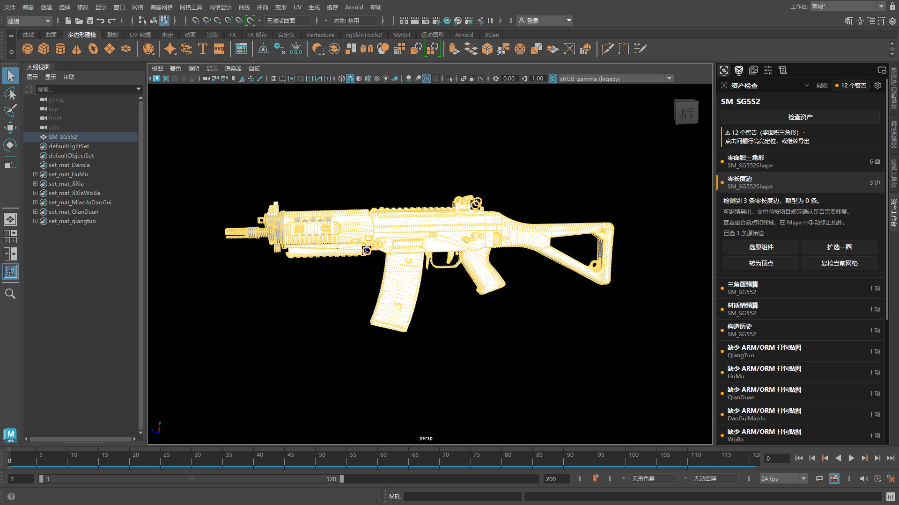
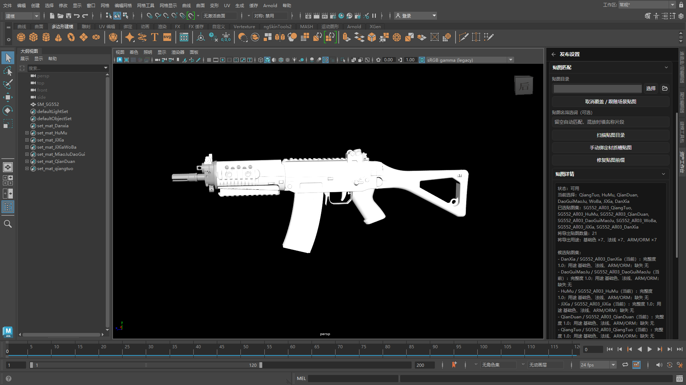
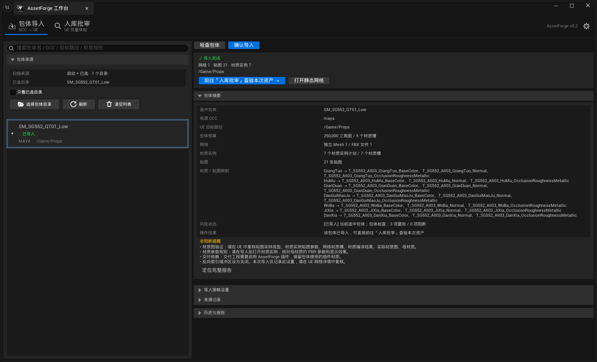
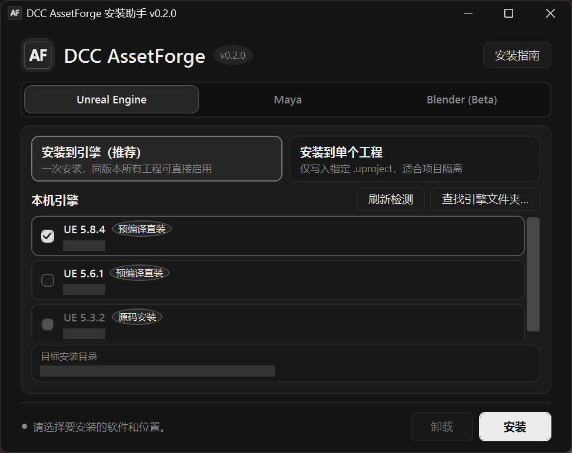
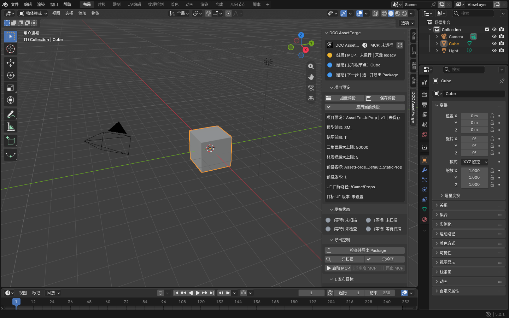
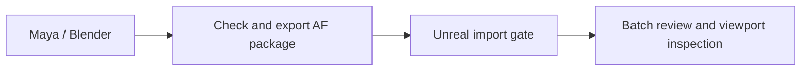

# DCC AssetForge

**[简体中文](README.zh-CN.md)** · [v0.2.0 release](https://github.com/Elviszhuoyu/DCC-AssetForge/releases/tag/v0.2.0)

[](https://github.com/Elviszhuoyu/DCC-AssetForge/actions/workflows/ci.yml)

DCC AssetForge is an open-source, DCC-to-Unreal workflow for technical artists and art teams. It turns a Maya or Blender static prop into an auditable package, then lets an Unreal Editor gate review the package before importing it.

> DCC AssetForge is an independent project. It is not affiliated with, endorsed by, or sponsored by Autodesk, Blender Foundation, or Epic Games. Maya, Blender, and Unreal Engine are trademarks of their respective owners.

## Windows quick install

**[Download DCC-AssetForge-v0.2.0-Win64.zip](https://github.com/Elviszhuoyu/DCC-AssetForge/releases/download/v0.2.0/DCC-AssetForge-v0.2.0-Win64.zip)** · [SHA-256 file](https://github.com/Elviszhuoyu/DCC-AssetForge/releases/download/v0.2.0/DCC-AssetForge-v0.2.0-Win64.zip.sha256) · [Release notes](RELEASE_NOTES.md)

1. Right-click the ZIP, choose **Extract All**, and select a local folder with an ASCII-only path and no spaces. Keep `Payload` beside the EXE.
2. Double-click **DCC-AssetForge-Setup.exe** in the extracted folder. Setup uses Windows .NET Framework 4.8.
3. Choose the host and version, check the destination, and click **安装** (Install). For Unreal, choose engine installation to share the plugin across projects, or project installation for a single `.uproject`. If the plugin is already installed in the engine, enable it under **Edit → Plugins** in the new project.

If Setup flags non-ASCII characters, spaces, or OneDrive, close it and move the entire extracted folder to a local folder outside the sync location, then reopen Setup.

### If Windows shows SmartScreen

Setup is unsigned. Confirm that the ZIP came from the official release before choosing **More info**, then **Run anyway**. If those buttons are unavailable on a managed PC, use manual installation or contact the administrator. [Microsoft SmartScreen guidance](https://learn.microsoft.com/en-us/windows/apps/package-and-deploy/publish-first-app#step-6-handle-smartscreen-for-new-apps)



*Button sequence diagram.*

### Manual installation

| Host | Steps |
| --- | --- |
| Maya | Open Maya and drag `Install_DCC_AssetForge_Maya.py` from the extracted folder into the viewport. Click **AF** on the **AssetForge** shelf. |
| Unreal Editor | Close the editor and copy the matching `AssetForge` folder from `Payload/Unreal` into the engine or project's `Plugins` folder. Reopen the project and enable **DCC AssetForge** in **Edit → Plugins**. |
| Blender | Open **Edit → Preferences → Get Extensions**, choose **Install from Disk**, and select `Payload/Blender/DCC-AssetForge-Blender-v0.2.0.zip`. |

For the exact Unreal folder locations, source builds, updates and removal, see the [installation guide](安装指南.md).

## First export and import

1. **Check and export in Maya.** Select a static prop, click **AF** on the **AssetForge** shelf, then choose **检查资产** and **检查并导出 Package**. For the Blender Beta export path, open **DCC AssetForge** in the 3D View sidebar (N).
2. **Check and import in Unreal.** Click **AF** on the toolbar, open **包体导入**, select the exported package, and choose **检查包体**. Confirm the destination and write policy before clicking **确认导入**.
3. **Review the imported assets.** Open **入库批审** from the import result. Review the mesh, material slots, textures, and checks. Finish with a viewport inspection.

## In the hosts

### Maya · asset checks and component location



<details>
<summary>Maya texture matching and the 21-texture count</summary>



</details>

### Unreal Editor · SG552 material render


<details>
<summary>Unreal package import receipt and batch review</summary>




The SG552 sample's batch review uses a limit of eight material slots. The imported mesh uses seven.

</details>

### Windows installer and Blender Beta

<details>
<summary>Windows installer · Unreal engine installation</summary>



</details>

<details>
<summary>Blender 5.2.1 LTS · basic export sidebar (Beta)</summary>



</details>

Local folder paths are masked where they appear.

## Host compatibility

| Host | Support and verification |
| --- | --- |
| Maya 2022–2026 | Python 3. Uses PySide2 through Maya 2024 and PySide6 for 2025–2026. Maya 2024.2 passed manual drag-and-drop installation, workbench reopen, a 21-texture sample, and 100% and 150% layout checks. Other versions have limited host verification. |
| Unreal Editor 5.8.4 Win64 | Precompiled for the exact patch and engine build. The final engine-level Gate build passed an actual asset import. Engine and project installation, cold start and uninstall were also checked on v0.2.0 candidates. |
| Unreal Editor 5.6.1 Win64 | Precompiled for the exact patch and engine build. An earlier v0.2.0 candidate passed project installation, workbench launch, and loading 36 stock assets. The final WPF install path was not repeated on this version. |
| Other Unreal Editor 5.3–5.8 builds | Project-level source installation requires a compatible Visual Studio C++ toolchain and Windows SDK. UE 5.3–5.5 may be unable to read the bundled stock assets saved in UE 5.6.1, even if the plugin builds. Source builds and imports have not been verified for each version. |
| Blender 4.2 LTS–5.x | Basic export support (Beta). Blender 5.2.1 LTS passed an isolated installation and removal smoke test. The final extension sidebar was opened in Blender 5.2.1. Other versions have not been tested in the desktop app. |
| 3ds Max | Unsupported in v0.2.0. |

Automatic Maya installation through Setup and the Windows administrator prompt remain unverified. Before removing an engine-level UE plugin, disable it in the projects using it.

## Why it exists

Inconsistent names and misrouted packed texture channels often surface late in Unreal. Artists then repeat exports and fixes, while reviewers reconstruct the same material and import decisions by hand.

- **Asset checks and the Unreal import gate.** Check naming, mesh budgets and texture inputs before export. Review the package and expected changes in Unreal before writing assets.
- **Painter PBR and ARM.** Recognize Substance 3D Painter's Unreal texture exports for base color, normal and packed ARM/ORM. ARM uses red for ambient occlusion, green for roughness, and blue for metallic.
- **Incremental material reuse.** Reuse compatible material instances and texture assets according to the selected import policy. Review what will be reused or updated before confirming.
- **Unreal batch review.** Review imported static meshes and textures, locate issues, preview eligible texture fixes, and compare subsequent reviews.
- **Shared JSON project presets.** Use one preset to share naming, budgets, texture matching, material profiles and target paths across a team. [Example preset](config/project_settings.example.json)

## Workflow



Each package carries the exchange asset, textures, a project preset snapshot, an export report, and material binding records for review.

## Stability boundary

Relatively stable:

- Static-prop manifest, report, project-preset, and package-naming contracts.
- Offline scan/check planning and the host-independent test suite.
- Explicit texture-folder preference and recorded fallback sources.
- UE Gate check/import separation and cleanup preview model.

Experimental or host-sensitive:

- Real Maya/Blender UI behavior across versions and user configurations.
- Unreal material graph appearance, binary assets, and final viewport quality.
- MCP bridges, which expose a fixed action allowlist but still require local-host configuration.
- Skeletal mesh, animation, virtual-texture, Nanite, and LOD policies beyond the documented static-prop baseline.

## Repository layout

```text
asset_forge/                 Core Python package and shared contracts
integrations/                Maya, Blender, and local MCP integration entry points
Plugins/AssetForge/          Unreal Editor plugin source and Python bootstrap
config/                      Example project presets, rules, and material profiles
examples/                    Redacted manifest examples
scripts/                     Installation, launch, import, and validation helpers
tests/                       Host-independent regression and contract tests
```

## Inspect mesh components in Maya

Select the asset root and choose **检查资产** in the docked workbench. Click a zero-area face or zero-length edge issue to select the reported faces or edges and show their markers. Choose **转为顶点** to inspect the directly affected vertices, or **扩选一圈** for their neighbors. After making a correction, use **复检当前网格** to recheck that mesh. Export still checks the full asset.

## Review assets in the Unreal Content Browser

Select static meshes, textures or a folder. Open **DCC AssetForge 资产体检** from the context menu and scan the selection. Pick an asset on the left to inspect its issues on the right. Double-click an issue or use its locate button to select the object in the Content Browser.

For a repairable texture, choose **预览修复影响** to review the current settings, proposed changes and affected references. **确认修改并复扫** saves the approved texture changes and checks the current asset again. After a revised delivery, use **复验当前资产** to compare results. Open **批次记录** to return to a batch or **返修单** to read the current round's HTML work order. Each round is retained under the project's `Saved/AssetForge/Reviews`.

## Opaque PBR and studio parents

Select `Props_Opaque_PBR` for opaque static props. Each slot requires an sRGB base color, a linear tangent-space normal and a linear ORM texture (red occlusion, green roughness, blue metallic). Its Opaque / Default Lit parent uses three texture samples.

To use a studio parent, copy the profile under a new name in `config/material_profiles.json`. Set `master_material` to the project's Unreal asset path and `allow_external_master_material` to `true`. Configure shader parameter names in `texture_rules` and optional feature-specific parents in `material_variants`. A declared variant takes precedence over the profile parent. Install the studio materials in the target project. The UE gate uses the shipped profile snapshot and checks the planned texture parameters against the real project parent before import.

For a coated cover, add `"material_variants": {"coating": "/Game/Studio/Materials/M_Coating"}` and `"material_slot_variants": [{"material": "M_Cover", "variant": "coating"}]` to the same project profile. An exact exported material name takes precedence over texture features. Assets without that slot use their usual parents. Duplicate routes, undeclared variants and external parents without permission block import.

## Compatibility identifiers

The public brand is **DCC AssetForge**. The following internal identifiers remain unchanged in v0.2.0 because renaming them would break manifests, scripts, imports, or host registrations:

- Python package and Blender extension ID: `asset_forge`
- Unreal plugin/module and mount: `AssetForge`, `AssetForgeEditor`, `/AssetForge`
- Environment variables and report/schema keys: `ASSET_FORGE_*`, `asset_forge_*`
- Legacy log category and shelf IDs containing `AssetForge`

New user-facing titles, manifests, documentation, and release names use DCC AssetForge. Compatibility identifiers are not a second brand.

Set the optional engine version in the project preset to have Unreal Gate check the major and minor engine version before import. [Example preset](config/project_settings.example.json)

## Contributing and security

See [CONTRIBUTING.md](CONTRIBUTING.md) before proposing changes and [SECURITY.md](SECURITY.md) before reporting a vulnerability. Do not attach proprietary scenes, textures, engine binaries, private project paths, or live credentials to issues.

## License and third-party software

Developed by **卓雨 (Elviszhuoyu)**. [Author's website](https://work.zhuoyulabs.com)

Original project code and documentation are licensed under the [MIT License](LICENSE). The DCC AssetForge project name and six original AF icons are excluded from MIT and use the separate [Brand Asset Policy](BRAND_ASSET_POLICY.md). Host applications and optional dependencies are not bundled and remain subject to their own licenses and terms. See [NOTICE.md](NOTICE.md) and [THIRD_PARTY_NOTICES.md](THIRD_PARTY_NOTICES.md).

<details>
<summary>Advanced: silent and IT deployment</summary>

For project deployments from the release ZIP, use `Install_DCC_AssetForge_Unreal.ps1` with `-CheckOnly` to preview or `-Source` to select source installation. [Command example](安装指南.md)

Run these development commands from the **source repository root** with the relevant host closed.

```powershell
py -3 -m venv .venv
.\.venv\Scripts\python.exe -m pip install -r requirements-dev.txt
.\.venv\Scripts\python.exe -m unittest discover -s tests -p "test_*.py"
py -3 scripts\unreal_plugin_install.py "<PROJECT.uproject>" --dry-run
py -3 scripts\blender_install_asset_forge_extension.py --repo-root . --blender-version 5.2
py -3 -c "from asset_forge.shared.sample_static_prop_package import create_offline_static_prop_package; print(create_offline_static_prop_package('.tmp/public-sample'))"
```

Confirm the Unreal dry run, then remove `--dry-run` to install the source plugin. Compile the Editor target with the engine used by that project. The Blender development installation uses the checkout at runtime. For portable Blender, select the add-on directory with `--user-addons-dir`.

</details>
