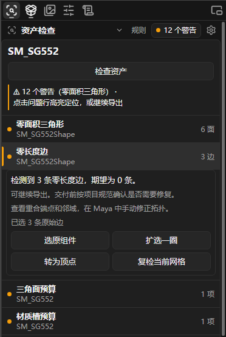
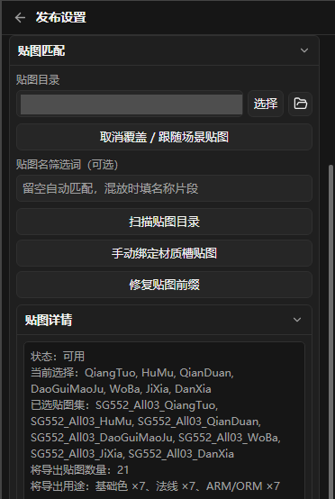
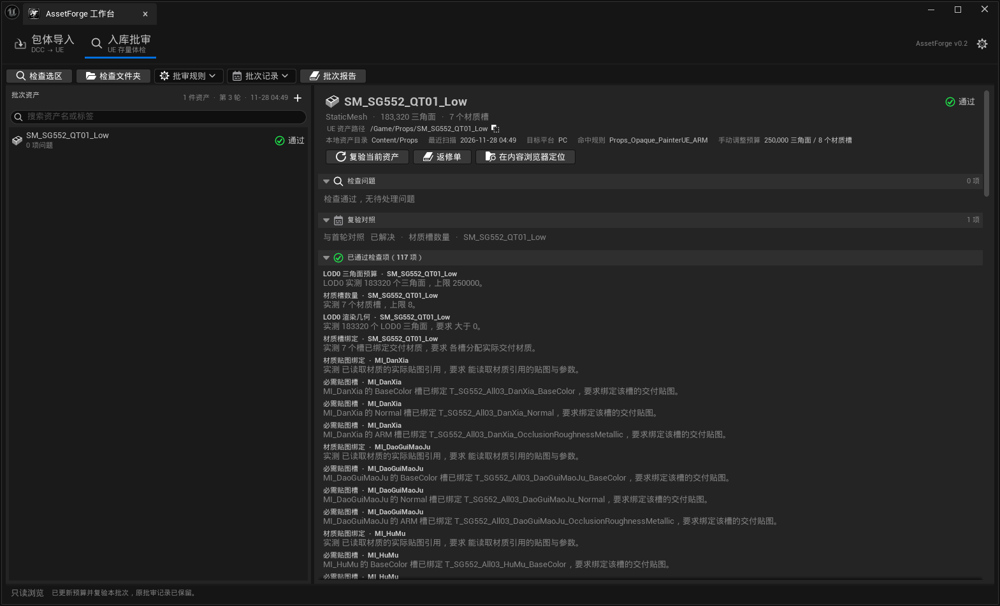

<h1 align="center">DCC AssetForge</h1>

<strong>把 Maya 或 Blender 里的静态道具交给 Unreal Editor</strong> 导出前先查一遍模型和贴图，接手的同事可以在 UE 里接着核对。

<strong>简体中文</strong> · <a href="README.en.md">English</a>

<a href="https://github.com/Elviszhuoyu/DCC-AssetForge/releases/download/v0.2.0/DCC-AssetForge-v0.2.0-Win64.zip"><strong>下载 v0.2.0 · Windows 64 位</strong></a> · <a href="#快速开始">快速开始</a> · <a href="#工具界面">工具界面</a> · <a href="#兼容范围">兼容范围</a>

## 为什么做 DCC AssetForge

一个道具在 Maya 里看着没问题，进 UE 才发现贴图接错了。回去改、再导一遍，接手的同事还得弄清楚这次用了哪套贴图、哪些地方已经检查过。做 AssetForge 时，我想省掉的就是这段来回。所以包体里会留下这次用的项目预设、贴图怎么接的记录和检查结果。交给同事，他们可以接着查。

- 团队可以共用一份 **JSON 项目预设**。模型怎么命名、面数上限是多少、要导到哪个目录，都写在这份文件里。Maya 查到有问题的面或边，可以点那条结果过去看。
- 用 Substance 3D Painter 导出的 PBR 贴图，AssetForge 会按命名匹配基础色、法线和 ARM/ORM。在 UE 里先看目标目录和材质槽，导入时选了复用，符合条件的材质实例和贴图可以继续用。
- 模型或贴图改好后，再跑一次「入库批审」，对照上轮看看问题解决了没有。最后到 UE 的视口里看一眼实际效果。

## 工具界面

### Unreal Editor · 包体导入

选中包体，先看看资产会导到哪里、贴图会接到哪个材质槽。导入完成后，点回执上的按钮就能检查刚导进来的资产。

这次导入 SG552，写入了 1 个网格、21 张贴图和 7 个材质实例。包体检查有 3 条提醒，0 项阻断。

### Maya · 资产检查与贴图匹配

左图查出了 3 条零长度边。点那条结果，Maya 就会选中对应的边。右图是「贴图匹配」，可以按材质槽核对基础色、法线和 ARM/ORM。

  
  

[查看 Maya 1920×1080 检查原图](docs/images/maya-workbench.png) · [查看 1920×1080 贴图匹配原图](docs/images/maya-texture-settings.png)

### Unreal Editor · 入库批审

改完以后重新检查一遍，可以和上轮结果对照，看看还有哪些问题没处理。

SG552 用了 7 个材质槽，包体起初给的上限是 5。演示时把这批的上限改成 8，再检查一遍，117 项全部通过。

### Blender · 基础导出（Beta）

在 3D 视图按 <kbd>N</kbd>，找到「DCC AssetForge」侧栏。选中模型后，可以先点「只检查」，也可以直接点「检查并导出 Package」。

[查看 Blender 宿主原图](docs/images/blender-export-beta.png)

### SG552 · Unreal 实机渲染

## 快速开始

### Windows 安装助手

1. 下载上面的 Windows ZIP，完整解压到**纯英文、无空格**的本地文件夹。`Payload` 要和 EXE 放在一起。
2. 双击 **DCC-AssetForge-Setup.exe**，选好软件、版本和安装位置，再点「安装」。
3. 如果已经装到 UE 引擎里，新建工程后在「编辑 → 插件」勾选 **DCC AssetForge** 就能用。只给一个项目装时，选工程级安装。

如果 Windows 弹出 SmartScreen，先确认文件是从这个仓库的发布页下载的，再点「更多信息」→「仍要运行」。[安装、手动安装与卸载指南](安装指南.md) · [下载 SHA-256 校验文件](https://github.com/Elviszhuoyu/DCC-AssetForge/releases/download/v0.2.0/DCC-AssetForge-v0.2.0-Win64.zip.sha256)

### 第一次导出和导入

1. 在 Maya 里选中道具，从「AssetForge」工具架打开 **AF**。先点「检查资产」，再点「检查并导出 Package」。Blender 的入口在 N 侧栏。
2. 在 UE 工具栏点 **AF**，选刚才导出的包体，点「检查包体」。看清目标目录后再点「确认导入」。
3. 从导入回执打开「入库批审」，核对网格、材质槽和贴图。最后在 UE 视口里看一眼道具的效果。

## 兼容范围

| 软件 | 当前支持 | 实测情况 |
| --- | --- | --- |
| Maya 2022–2026 | Python 3，2022–2024 使用 PySide2，2025–2026 使用 PySide6 | Maya 2024.2 验证了拖放安装、工作台和贴图样例。其他版本按标准接口兼容，未逐版实测。 |
| UE 5.8.4 / 5.6.1 Win64 | 两版提供对应构建的预编译插件 | UE 5.8.4 已走通引擎级安装后的真实导入和批审。UE 5.6.1 已验证候选版工程级安装、工作台和内置资源加载。 |
| UE 5.3–5.8 其他构建 | 可选工程级源码安装，需要兼容的 Visual Studio C++ 编译工具和 Windows SDK | 尚未逐版测试。UE 5.3–5.5 可能读不出包里以 UE 5.6.1 保存的资源。 |
| Blender 4.2 LTS 起 | 基础导出（Beta） | Blender 5.2.1 LTS 已验证安装、打开侧栏和卸载。 |
| 3ds Max | 暂不支持 | — |

## 文档与许可

[中文版使用手册](README.zh-CN.md) · [English guide](README.en.md) · [v0.2.0 发布说明](RELEASE_NOTES.md) · [反馈问题](https://github.com/Elviszhuoyu/DCC-AssetForge/issues)

开发者 **卓雨 / Elviszhuoyu**。代码与文档采用 **MIT License**，品牌素材的使用范围另有说明。[作者主页](https://work.zhuoyulabs.com) · [MIT License](LICENSE) · [品牌素材许可](BRAND_ASSET_POLICY.md)
