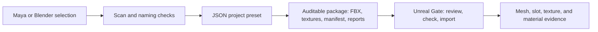

# DCC AssetForge

[简体中文](README.zh-CN.md)

[](https://github.com/Elviszhuoyu/DCC-AssetForge/actions/workflows/ci.yml)

DCC AssetForge is an open-source, DCC-to-Unreal workflow for technical artists and art teams. It turns a Maya or Blender static prop into an auditable package, then lets an Unreal Editor gate review the package before importing it.

The repository is public and preparing its first tagged GitHub release. The code manifests currently identify the project as `0.1.0`; there is no tagged release yet. Screenshots and GIFs are intentionally omitted until real host captures are available.

> DCC AssetForge is an independent project. It is not affiliated with, endorsed by, or sponsored by Autodesk, Blender Foundation, or Epic Games. Maya, Blender, and Unreal Engine are trademarks of their respective owners.

## Why it exists

A raw FBX export does not answer the questions a production team actually asks:

- Which project preset and naming policy produced this asset?
- Which textures and material profile were selected, and why?
- Did the mesh pass naming and budget checks before import?
- What did Unreal import, reject, or change?
- Can another artist or TA audit the result without reconstructing the original DCC session?

DCC AssetForge records those decisions and moves them through an explicit gate instead of relying on an opaque export button.

## Workflow



The main concepts are:

- **JSON project preset** — one readable contract for export roots, Unreal target paths, naming, budgets, material profiles, texture matching, and package versioning.
- **Auditable package** — a folder containing the exchange asset, textures, manifest, preset snapshot, export report, and material/texture binding evidence.
- **Naming checks** — validates mesh and texture prefixes while keeping the asset identity separate from the versioned package folder name.
- **UE Gate** — lists packages, runs a check before import, records import history, and previews cleanup candidates instead of silently deleting project content.
- **Material evidence** — records parent material selection, texture parameters, material instances, mesh slots, and validation status. It does not replace a real visual review in Unreal Editor.

## Current scope and evidence

| Area | Current evidence | Public support statement |
| --- | --- | --- |
| Core schemas, reports, naming, package checks | Host-independent automated tests | Maintained on `main` |
| Maya 2026 | Prior local static-prop workflow evidence | Implemented; fresh public-release host validation pending |
| Blender 5.1.2 | Prior local background and workbench evidence | Implemented; manifest minimum is 4.2, but 4.2–5.0 are not currently verified |
| Unreal Engine 5.6 | Prior local Gate/import/material evidence | Implemented; fresh clean-project and visual validation pending |
| Other Maya, Blender, or Unreal versions | No current evidence | Unverified |
| Skeletal mesh and animation | Partial research/code paths only | Experimental; not a supported release workflow |
| 3ds Max and standalone desktop app | No implementation claim | Out of scope |

“Prior local evidence” means those hosts were exercised during development. It does not mean every current commit has been rerun in a clean host environment. Host-dependent items remain unverified for the first public release until that rerun is completed.

## Stability boundary

Relatively stable:

- Static-prop manifest, report, project-preset, and package-naming contracts.
- Offline scan/check planning and the host-independent test suite.
- Explicit texture-folder preference and recorded fallback sources.
- UE Gate check/import separation and cleanup preview model.

Experimental or host-sensitive:

- Real Maya/Blender UI behavior across versions and user configurations.
- Unreal material graph appearance, binary assets, and final viewport quality.
- MCP bridges, which expose a fixed action allowlist but still require local-host configuration.
- Skeletal mesh, animation, virtual-texture, Nanite, and LOD policies beyond the documented static-prop baseline.

## Repository layout

```text
asset_forge/                 Core Python package and shared contracts
integrations/                Maya, Blender, and local MCP integration entry points
Plugins/AssetForge/          Unreal Editor plugin source and Python bootstrap
config/                      Example project presets, rules, and material profiles
examples/                    Redacted manifest examples
scripts/                     Installation, launch, import, and validation helpers
tests/                       Host-independent regression and contract tests
```

## Installation

Clone the repository into a path you control. Python 3.9 or newer is recommended for offline development and tests. Maya, Blender, and Unreal provide their own Python runtimes for host integration.

### Offline development environment

Windows PowerShell:

```powershell
py -3 -m venv .venv
.\.venv\Scripts\python.exe -m pip install -r requirements-dev.txt
.\.venv\Scripts\python.exe -m unittest discover -s tests -p "test_*.py"
```

Pillow is a development dependency and an optional runtime helper for flattening Maya playblast alpha. DCC and Unreal Python APIs are supplied by their host applications and are not installed from this repository.

### Maya

Run the following from Maya's Python Script Editor after replacing the two placeholders:

```python
repo_root = r"<REPOSITORY_ROOT>"
bootstrap_path = repo_root + r"\scripts\maya_launch_asset_forge.py"
scope = {"ASSET_FORGE_REPO_ROOT": repo_root, "ASSET_FORGE_BOOTSTRAP_PATH": bootstrap_path}
exec(compile(open(bootstrap_path, "rb").read(), bootstrap_path, "exec"), scope)
scope["bootstrap"](repo_root=repo_root, open_ui=True)
```

To add the optional shelf button, run the same bootstrap and then call:

```python
scope["install_ui_shelf_button"](repo_root=repo_root)
```

### Blender

The installer accepts an explicit add-on directory on any platform. Its automatic default currently targets the Windows Blender user directory.

```powershell
py -3 scripts\blender_install_asset_forge_extension.py `
  --repo-root . `
  --blender-version 5.1
```

Then enable **DCC AssetForge** in Blender Preferences and open the sidebar in the 3D View. For a non-Windows or portable Blender install, pass `--user-addons-dir <PATH>`.

This `0.1.0` workflow is a direct/manual add-on install. It is not a claim that the package is eligible for Blender's official Extensions Platform, which currently requires add-ons submitted there to use GPL-3.0-or-later.

### Unreal Engine

Close Unreal Editor before installing or rebuilding the C++ editor module. Start with a dry run:

```powershell
py -3 scripts\unreal_plugin_install.py "<PROJECT.uproject>" --dry-run
```

If the plan points only to the intended project, run the installer without `--dry-run`, build the project’s Editor target with its licensed Unreal Engine installation, then restart the editor. The repository does not include or redistribute Unreal Engine code or binaries.

## Minimal offline example

The sample generator creates a small redacted static-prop package without opening a DCC or Unreal Editor:

```powershell
py -3 -c "from asset_forge.shared.sample_static_prop_package import create_offline_static_prop_package; print(create_offline_static_prop_package('.tmp/public-sample'))"
```

Inspect the generated manifest and reports under `.tmp/public-sample`. This proves the package contract only; it does not prove a Maya/Blender export or Unreal import.

The example project preset is [config/project_settings.example.json](config/project_settings.example.json).

## Uninstallation

- **Offline checkout:** remove the virtual environment and the cloned repository when no longer needed. Generated reports and exported packages live outside the source tree unless you explicitly place them under it.
- **Maya:** remove the `assetForgeMayaWorkbenchButton` shelf button, remove any custom module entry you created, and restart Maya. The bootstrap does not copy Autodesk files.
- **Blender:** disable the add-on, then remove the `asset_forge_extension` folder from the user add-ons directory used during installation.
- **Unreal:** disable `AssetForge` in the `.uproject`, close the editor, remove `<PROJECT>/Plugins/AssetForge`, and regenerate/rebuild project files if required. Never remove the entire project `Plugins` directory.

Automatic uninstall is not provided in `0.1.0`; the paths above are intentionally explicit.

## Troubleshooting

- **Maya loads an older checkout:** use the bootstrap snippet above; it purges known DCC AssetForge modules and prepends the selected repository path.
- **Blender add-on is missing:** verify the `--user-addons-dir` and enable the add-on in Preferences. The internal extension ID remains `asset_forge` for compatibility.
- **UE plugin does not load:** confirm the editor is closed during the build, the plugin is under the target project, and the project’s Editor target compiled successfully.
- **No package appears in UE Gate:** verify the selected folder contains the generated manifest, not only an FBX.
- **Materials look wrong:** read the material evidence and slot/texture reports, then inspect the real graph and viewport. JSON readback alone is not visual acceptance.
- **Tests fail on Pillow:** install `requirements-dev.txt` in the Python environment running the tests.

## Compatibility identifiers

The public brand is **DCC AssetForge**. The following internal identifiers remain unchanged in `0.1.x` because renaming them would break manifests, scripts, imports, or host registrations:

- Python package and Blender extension ID: `asset_forge`
- Unreal plugin/module and mount: `AssetForge`, `AssetForgeEditor`, `/AssetForge`
- Environment variables and report/schema keys: `ASSET_FORGE_*`, `asset_forge_*`
- Legacy log category and shelf IDs containing `AssetForge`

New user-facing titles, manifests, documentation, and release names use DCC AssetForge. Compatibility identifiers are not a second brand.

## Contributing and security

See [CONTRIBUTING.md](CONTRIBUTING.md) before proposing changes and [SECURITY.md](SECURITY.md) before reporting a vulnerability. Do not attach proprietary scenes, textures, engine binaries, private project paths, or live credentials to issues.

## License and third-party software

Original project code and documentation are licensed under the [MIT License](LICENSE). The DCC AssetForge project name and six original AF icons are excluded from MIT and use the separate [Brand Asset Policy](BRAND_ASSET_POLICY.md). Host applications and optional dependencies are not bundled and remain subject to their own licenses and terms. See [NOTICE.md](NOTICE.md) and [THIRD_PARTY_NOTICES.md](THIRD_PARTY_NOTICES.md).
