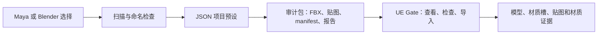

# DCC AssetForge

[English](README.md)

[](https://github.com/Elviszhuoyu/DCC-AssetForge/actions/workflows/ci.yml)

DCC AssetForge 是面向技术美术与美术团队的开源 DCC 到 Unreal 静态道具工作流。它把 Maya 或 Blender 中的资产整理为可审计包，再由 Unreal Editor 端的 Gate 先检查、后导入。

当前公开版本为 [v0.1.0](https://github.com/Elviszhuoyu/DCC-AssetForge/releases/tag/v0.1.0)，与 Python、Blender 和 Unreal 三处 manifest 一致。真实宿主截图和 GIF 尚未准备完成，因此首版使用架构图、命令和脱敏示例，不伪造展示素材。

> DCC AssetForge 是独立项目，与 Autodesk、Blender Foundation、Epic Games 没有隶属、背书或赞助关系。Maya、Blender、Unreal Engine 是其各自权利人的商标。

## 解决什么问题

普通 FBX 导出无法回答生产管线最关心的问题：资产使用了哪套团队标准、命名和预算是否通过、贴图与材质为什么这样匹配、UE 实际导入了什么，以及其他人能否复核整个过程。

DCC AssetForge 把这些决策写入 manifest 和报告，并让 UE Gate 显式检查，而不是把复杂流程藏在一个不可追踪的导出按钮后面。



核心概念：

- **JSON 项目预设**：统一导出目录、UE 目标路径、命名、预算、材质配置、贴图匹配和包体版本策略。
- **可审计包**：包含交换资产、贴图、manifest、预设快照、导出报告和材质/贴图绑定证据。
- **命名检查**：检查模型与贴图前缀，并把“资产身份”与“带版本的包体目录名”分离。
- **UE Gate**：列出包体，先检查后导入，记录导入历史，并先预览清理候选，不静默删除项目内容。
- **材质证据**：记录母材质、参数、贴图、材质实例和 mesh slot；它不能替代 UE 中的真实视觉验收。

## 当前支持边界

| 领域 | 当前证据 | 对外说明 |
| --- | --- | --- |
| Schema、报告、命名和包体检查 | 宿主无关自动化测试 | `main` 持续维护 |
| Maya 2026 | 既有本机 Static Prop 流程证据 | 已实现；公开版本的干净环境复验待完成 |
| Blender 5.1.2 | 既有本机后台与工作台证据 | 已实现；manifest 最低为 4.2，但 4.2–5.0 未验证 |
| Unreal Engine 5.6 | 既有本机 Gate、导入与材质证据 | 已实现；新的干净工程和视觉复验待完成 |
| 其他 DCC/UE 版本 | 没有当前证据 | `unverified` |
| Skeletal、Animation | 只有部分研究与代码路径 | 实验性，不属于首版支持工作流 |
| 3ds Max、独立桌面程序 | 没有完成证据 | 不在当前范围 |

“既有本机证据”只说明开发期间运行过，不代表本次整理后的每个提交都已重新在真实宿主中通过。未重新运行的宿主项不能标记为完成。

## 稳定与实验性能力

相对稳定：Static Prop 的 manifest/report/preset/package naming 合同、离线扫描与检查计划、显式贴图目录优先级、UE Gate 检查/导入分离和清理预览模型。

实验性或宿主敏感：跨版本 UI、UE 材质图最终外观、MCP Bridge、Skeletal/Animation，以及 VT、Nanite、LOD 等超出当前 Static Prop 基线的策略。

## 安装

克隆仓库到你可控制的目录。离线开发和测试建议使用 Python 3.9 或更新版本；Maya、Blender、Unreal 集成使用宿主自带 Python。

### 离线开发环境

```powershell
py -3 -m venv .venv
.\.venv\Scripts\python.exe -m pip install -r requirements-dev.txt
.\.venv\Scripts\python.exe -m unittest discover -s tests -p "test_*.py"
```

Pillow 是开发依赖，也可用于把 Maya playblast 的透明通道压成实色；Maya、Blender、Unreal Python API 由宿主提供，本仓库不分发。

### Maya

在 Maya Python Script Editor 中替换路径后执行：

```python
repo_root = r"<仓库根目录>"
bootstrap_path = repo_root + r"\scripts\maya_launch_asset_forge.py"
scope = {"ASSET_FORGE_REPO_ROOT": repo_root, "ASSET_FORGE_BOOTSTRAP_PATH": bootstrap_path}
exec(compile(open(bootstrap_path, "rb").read(), bootstrap_path, "exec"), scope)
scope["bootstrap"](repo_root=repo_root, open_ui=True)
```

如需安装可选 shelf 按钮，再执行：

```python
scope["install_ui_shelf_button"](repo_root=repo_root)
```

### Blender

```powershell
py -3 scripts\blender_install_asset_forge_extension.py `
  --repo-root . `
  --blender-version 5.1
```

然后在 Blender Preferences 中启用 **DCC AssetForge**。非 Windows 或便携版 Blender 请显式传入 `--user-addons-dir <路径>`。

`0.1.0` 采用直接/手动 add-on 安装，不代表当前包可以提交到 Blender 官方 Extensions Platform；该平台目前要求 add-on 使用 GPL-3.0-or-later。

### Unreal Engine

安装或编译 C++ Editor 模块前关闭 Unreal Editor，并先做预演：

```powershell
py -3 scripts\unreal_plugin_install.py "<项目.uproject>" --dry-run
```

确认目标只指向预期工程后，去掉 `--dry-run`，再用该工程合法安装的 Unreal Engine 构建 Editor Target 并重启 Editor。本仓库不包含或重新分发 Unreal Engine 代码和二进制。

## 最小离线示例

无需打开 DCC 或 UE，即可生成一个小型脱敏包：

```powershell
py -3 -c "from asset_forge.shared.sample_static_prop_package import create_offline_static_prop_package; print(create_offline_static_prop_package('.tmp/public-sample'))"
```

它只证明包体合同可生成，不证明 Maya/Blender 真实导出或 UE 真实导入。项目预设示例见 [config/project_settings.example.json](config/project_settings.example.json)。

## 卸载

- **离线环境**：删除虚拟环境与克隆目录；先自行保留需要的导出包和报告。
- **Maya**：删除 `assetForgeMayaWorkbenchButton` shelf 按钮和你自行添加的 module 入口，然后重启 Maya。
- **Blender**：禁用 add-on，再删除安装目录中的 `asset_forge_extension` 文件夹。
- **Unreal**：在 `.uproject` 禁用 `AssetForge`，关闭 Editor，仅删除 `<项目>/Plugins/AssetForge`，再按需重新生成/构建工程；不要删除整个 `Plugins` 目录。

`0.1.0` 不提供自动卸载，路径保持显式，避免误删其他插件。

## 故障排查

- Maya 载入旧仓库：重新使用上面的 bootstrap，它会清理已知模块并把指定仓库放到 `sys.path` 前部。
- Blender 找不到 add-on：核对 `--user-addons-dir` 并在 Preferences 启用；内部扩展 ID 为兼容性继续保留 `asset_forge`。
- UE 插件不加载：确认构建时 Editor 已关闭、插件位于目标项目目录、Editor Target 已成功编译。
- UE Gate 找不到包：应选择包含 manifest 的包体目录，不能只给一个 FBX。
- 材质效果错误：先看材质证据、slot 和贴图报告，再检查真实材质图与视口；JSON 读回不等于视觉验收。
- 测试缺少 Pillow：在运行测试的 Python 环境安装 `requirements-dev.txt`。

## 品牌与兼容标识

对外品牌统一为 **DCC AssetForge**。`0.1.x` 暂时保留以下内部标识，避免破坏脚本、manifest、导入路径和宿主注册：

- Python 包与 Blender 扩展 ID：`asset_forge`
- UE 插件、模块与 mount：`AssetForge`、`AssetForgeEditor`、`/AssetForge`
- 环境变量、schema、报告键：`ASSET_FORGE_*`、`asset_forge_*`
- 含 `AssetForge` 的旧日志 category 与 shelf ID

这些是兼容标识，不是第二套品牌。新的用户标题、manifest、文档和 Release 名称统一使用 DCC AssetForge。

## 贡献、安全与许可证

贡献前请阅读 [CONTRIBUTING.md](CONTRIBUTING.md)，安全问题请阅读 [SECURITY.md](SECURITY.md)。Issue 中不要附带专有场景、贴图、引擎二进制、私人路径或真实凭据。

原创代码和文档采用 [MIT License](LICENSE)。DCC AssetForge 项目名称和六枚原创 AF 图标不纳入 MIT，适用单独的 [品牌资产政策](BRAND_ASSET_POLICY.md)。宿主软件和可选依赖不随仓库分发，继续受其各自许可证和条款约束。详见 [NOTICE.md](NOTICE.md) 与 [THIRD_PARTY_NOTICES.md](THIRD_PARTY_NOTICES.md)。
