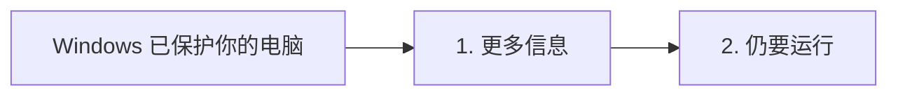
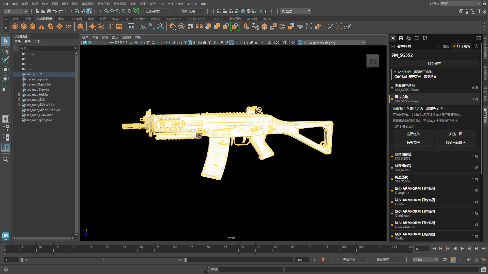
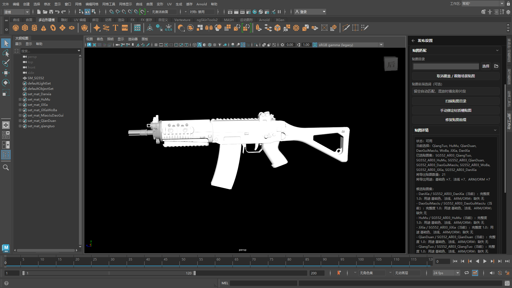
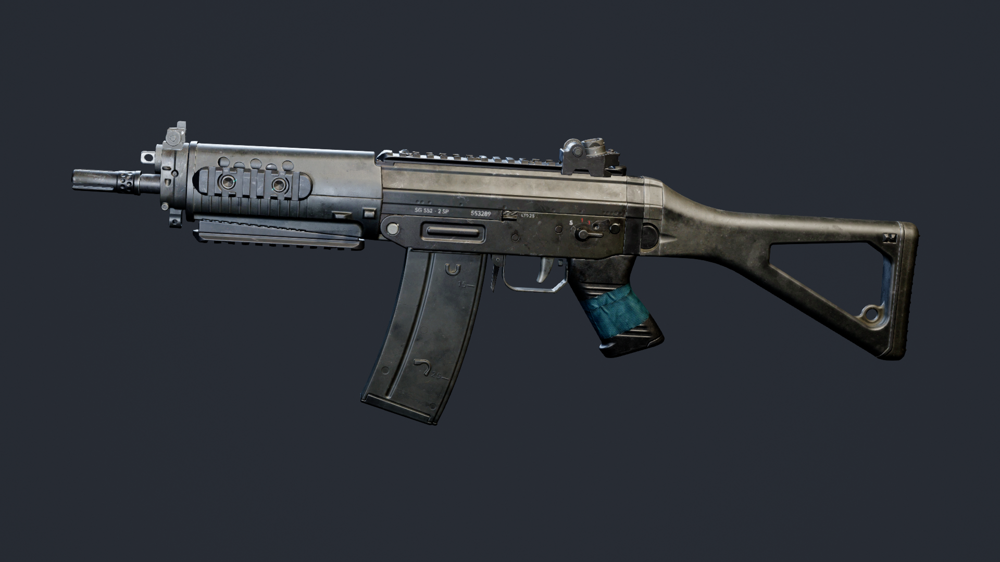
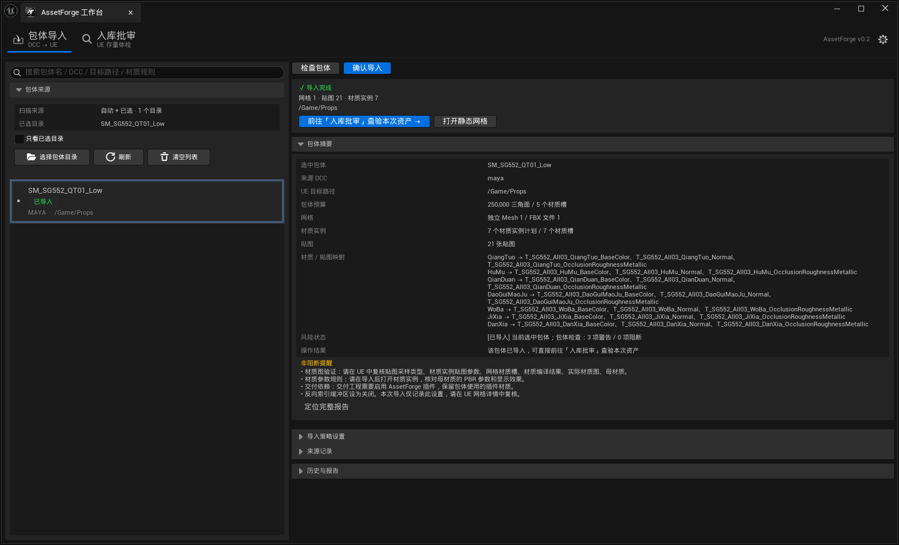
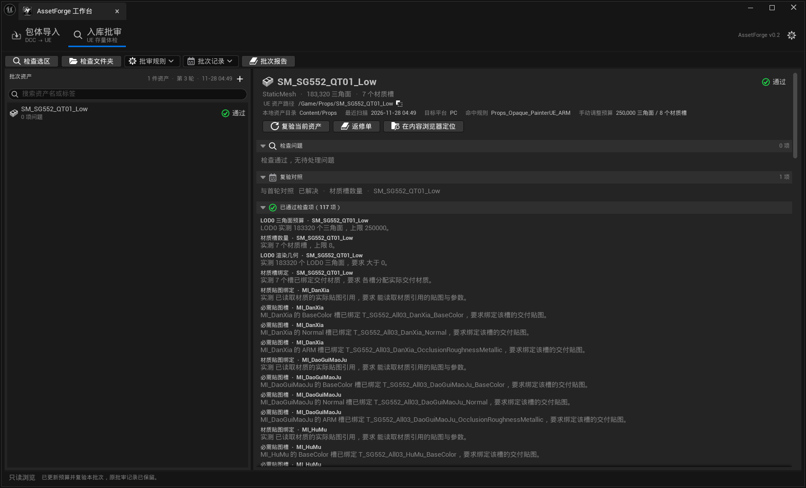
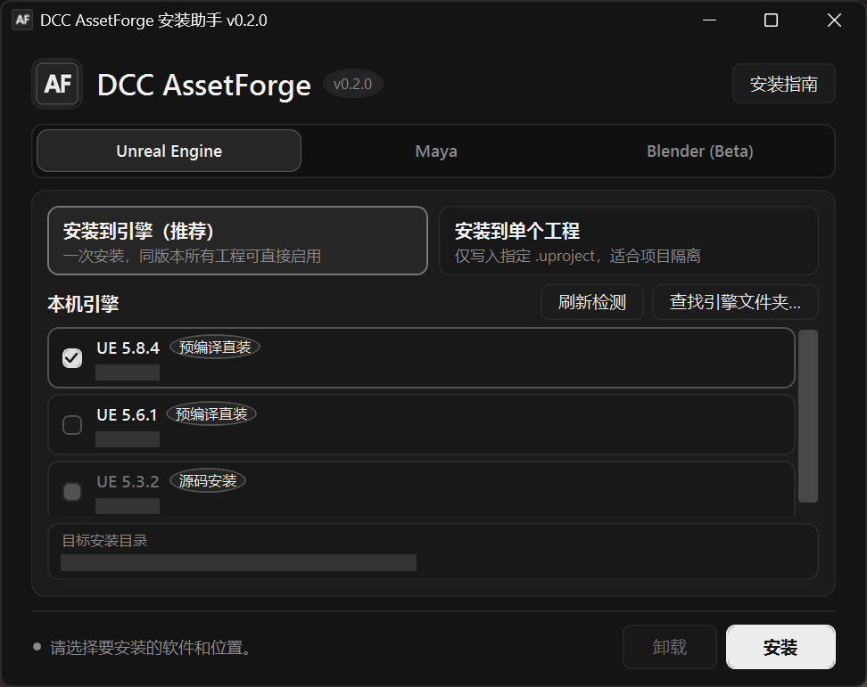
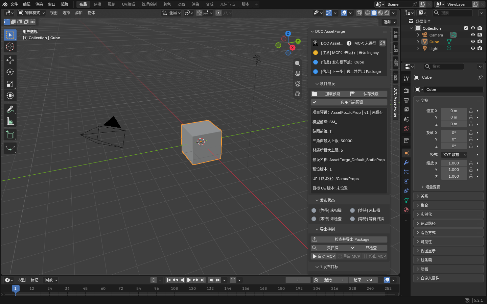
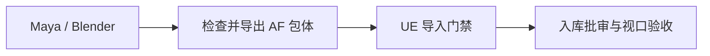

# DCC AssetForge

**[English](README.md)** · [v0.2.0 发行页](https://github.com/Elviszhuoyu/DCC-AssetForge/releases/tag/v0.2.0)

[](https://github.com/Elviszhuoyu/DCC-AssetForge/actions/workflows/ci.yml)

DCC AssetForge 是面向技术美术与美术团队的开源 DCC 到 Unreal 静态道具工作流。它把 Maya 或 Blender 中的资产整理为可审计包，再由 Unreal Editor 端的 Gate 先检查、后导入。

> DCC AssetForge 是独立项目，与 Autodesk、Blender Foundation、Epic Games 没有隶属、背书或赞助关系。Maya、Blender、Unreal Engine 是其各自权利人的商标。

## 1 分钟安装 · Windows 64 位

**[下载 DCC-AssetForge-v0.2.0-Win64.zip](https://github.com/Elviszhuoyu/DCC-AssetForge/releases/download/v0.2.0/DCC-AssetForge-v0.2.0-Win64.zip)** · [SHA-256 校验文件](https://github.com/Elviszhuoyu/DCC-AssetForge/releases/download/v0.2.0/DCC-AssetForge-v0.2.0-Win64.zip.sha256) · [发布说明](RELEASE_NOTES.md)

1. 右键点击 ZIP，选择「全部解压缩」。请解压至纯英文、无空格的本地目录，保留 EXE 旁边的 `Payload` 文件夹。
2. 双击根目录的 **DCC-AssetForge-Setup.exe**。安装助手使用 Windows 的 .NET Framework 4.8。
3. 选择宿主和版本，核对目标目录，点「安装」。若多个 UE 工程共用插件，选择引擎级安装。若只需为一个 `.uproject` 安装，选择工程级安装。已有引擎级副本时，新工程直接在「编辑 → 插件」启用即可。

安装助手若提示目录含中文、空格或位于 OneDrive，请关闭安装助手，把整个解压目录移到本地非同步位置，再从新位置重新打开。

### 遇到 Windows SmartScreen

安装程序未签名。确认 ZIP 来自官方发布页后，如果看到「Windows 已保护你的电脑」，点「更多信息」，再点「仍要运行」。如果单位电脑未提供相关按钮，请手动安装或联系管理员。[Microsoft SmartScreen 说明](https://learn.microsoft.com/en-us/windows/apps/package-and-deploy/publish-first-app#step-6-handle-smartscreen-for-new-apps)



*操作顺序示意图。*

### 手动安装

| 宿主 | 操作 |
| --- | --- |
| Maya | 打开 Maya，将解压目录里的 `Install_DCC_AssetForge_Maya.py` 拖进视口。到「AssetForge」工具架点 **AF**。 |
| Unreal Editor | 关闭编辑器，从 `Payload/Unreal` 选择匹配版本，把 `AssetForge` 文件夹复制到引擎或工程的 `Plugins`。重开工程，在「编辑 → 插件」中启用 **DCC AssetForge**。 |
| Blender | 打开「编辑 → 偏好设置 → 获取扩展」，选择「从磁盘安装」，选中 `Payload/Blender/DCC-AssetForge-Blender-v0.2.0.zip`。 |

UE 的具体目录、源码编译、升级与卸载步骤见 [安装指南](安装指南.md)。

## 三步完成首次导入

1. **在 Maya 检查并导出。** 选中静态道具，在「AssetForge」工具架点 **AF**，依次点「检查资产」和「检查并导出 Package」。Blender 的 Beta 导出入口位于 3D 视图的 N 侧栏。
2. **在 UE 检查并导入。** 点工具栏 **AF**，在「包体导入」选择完整包体并点「检查包体」。核对目标和写入策略后点「确认导入」。
3. **做一次入库批审。** 从导入结果进入「入库批审」，核对网格、材质槽、贴图和检查结果，再到 UE 视口确认外观。

## 实机展示

### Maya · 体检与一键定位



<details>
<summary>展开 Maya 贴图匹配与 21 张贴图汇总</summary>



</details>

### Unreal Editor · SG552 道具渲染



<details>
<summary>展开 UE 导入成功回执与入库批审</summary>





SG552 实际使用 7 个材质槽。图中将本批次预算设为 8 个槽后复验通过。

</details>

### Windows 安装助手与 Blender Beta

<details>
<summary>展开 Windows 安装助手的 UE 引擎级安装页</summary>



</details>

<details>
<summary>展开 Blender 5.2.1 LTS 基础导出侧栏（Beta）</summary>



</details>

画面中的本机目录已遮挡。

## 兼容性

| 宿主 | 支持与验证范围 |
| --- | --- |
| Maya 2022–2026 | 使用 Python 3。2022–2024 用 PySide2，2025–2026 用 PySide6。Maya 2024.2 已验证拖拽安装、工作台重开、21 张贴图样例和 100% / 150% 缩放布局。其他版本未逐版实机验收。 |
| Unreal Editor 5.8.4 Win64 | 预编译版需匹配引擎补丁和构建编号。最终引擎级门禁已完成实际资产导入。v0.2.0 候选阶段也验证过引擎级、工程级安装、冷启动及卸载。 |
| Unreal Editor 5.6.1 Win64 | 预编译版需匹配引擎补丁和构建编号。早先的 v0.2.0 候选已验证工程级安装、工作台启动和读取 36 项内置资源。最终 WPF 安装路径未在该版本重测。 |
| UE 5.3–5.8 其他构建 | 可进行工程级源码安装，需要匹配的 Visual Studio C++ 工具和 Windows SDK。随包内置资源用 UE 5.6.1 保存。UE 5.3–5.5 即使编译成功也可能无法读取。源码安装及导入未逐版本实机验收。 |
| Blender 4.2 LTS–5.x | 基础导出支持（Beta，已在 Blender 5.2.1 LTS 冒烟验证）。独立配置下验证了安装、桌面侧栏打开与卸载，其他版本未逐版实测。 |
| 3ds Max | 暂不支持。 |

安装助手自动安装 Maya 和 Windows 管理员权限提示尚未实测。UE 引擎级卸载前，先在使用此插件的工程中禁用它。

## 解决什么问题

命名不统一、贴图通道错配，常常到了 UE 导入或验收才暴露。制作者反复导出返工，验收人员也得逐项追查材质绑定、写入目标和历史结果。

- **资产体检与导入门禁。** 导出前检查命名、网格预算和贴图输入，进入 UE 后先查看包体检查结果和预期写入，再决定是否导入。
- **识别 Painter PBR 与 ARM。** 按 Substance 3D Painter 的 Unreal 导出约定识别基础色、法线及 ARM/ORM 打包图。ARM 的 R、G、B 分别为环境遮蔽、粗糙度和金属度。
- **增量材质复用。** 根据导入策略复用可兼容的材质实例和贴图资产，导入前核对哪些会复用或更新。
- **UE 入库批审。** 导入后定位静态网格和贴图的问题，预览可修复项的改动，复验时对比各轮结果。
- **共享 JSON 项目预设。** 团队用同一份预设统一命名、预算、目标目录、贴图匹配和材质配置。[项目预设示例](config/project_settings.example.json)

## 工作流



包体保存交换资产、贴图、项目预设快照、导出报告和材质绑定记录，便于制作者和验收人员复查。

## 稳定与实验性能力

相对稳定：Static Prop 的 manifest/report/preset/package naming 合同、离线扫描与检查计划、显式贴图目录优先级、UE Gate 检查/导入分离和清理预览模型。

实验性或宿主敏感：跨版本 UI、UE 材质图最终外观、MCP Bridge、Skeletal/Animation，以及 VT、Nanite、LOD 等超出当前 Static Prop 基线的策略。

## Maya 网格检查与定位

选择资产根，在停靠面板点 **检查资产**。点击零面积面或零长度边的问题行，面板会选中报告中的面或边并显示定位标记。点 **转为顶点** 查看直接关联顶点，或点 **扩选一圈** 查看周围顶点。修正后点 **复检当前网格** 检查局部修改，导出前仍会检查整个资产。

## UE 存量资产体检

在内容浏览器选中静态网格、贴图或文件夹，右键打开 **DCC AssetForge 资产体检**，选择对应的检查动作。在工作台左侧选择一件资产，右侧显示问题、测得的属性和定位入口。双击问题行也可在内容浏览器定位对象。

对可修贴图点 **预览修复影响**，核对旧值、目标值和引用范围。**确认修改并复扫** 只保存允许修改的贴图，并重新检查当前资产。制作者交回资产后，点 **复验当前资产** 查看差异。可以从 **批次记录** 回到原批次，或点 **返修单** 打开当前轮 HTML。各轮返修单保存在工程的 `Saved/AssetForge/Reviews` 下。

## 不透明 PBR 与项目父材质

在 DCC 工作台选择 `Props_Opaque_PBR`。每个槽应有三张纹理：sRGB 底色、线性切线空间法线，以及 R=AO、G=Roughness、B=Metallic 的线性 ORM。该预设用独立的 Opaque / Default Lit 父材质。AO 强度为 0 时输出 1，为 1 时保持源 AO。

要接入自己的材质库，在项目的 `config/material_profiles.json` 中复制这个预设并改名。将 `master_material` 设置为自己的 UE 资产路径（例如 `/Game/Studio/Materials/M_Prop`），设置 `allow_external_master_material` 为 `true`。按需要在 `material_variants` 中为特定类型指定父材质，例如 `"emissive": "/Game/Studio/Materials/M_Emissive"`，并在 `texture_rules` 中配置实际使用的贴图通道和参数名。明确指定的分支优先，其余使用本预设的父材质。目标工程需已安装这些项目材质。

若只有 `M_Cover` 使用项目涂装父材质，在同一预设设置 `"material_variants": {"coating": "/Game/Studio/Materials/M_Coating"}` 和 `"material_slot_variants": [{"material": "M_Cover", "variant": "coating"}]`。`material` 精确匹配 DCC 导出的材质名，优先于贴图特征；同一预设用于不含该槽的资产时沿用原有选择。重复规则、未声明的变体或未获准的外部父材质会阻断导入。

发布包随附预设快照。UE 会按快照检查父材质和所需纹理参数。若父材质缺失、参数名不匹配，或不透明 PBR 的某个槽缺少输入，先在 Gate 修正绑定，再导入。默认兼容预设仍可用于其他道具。透射、视差与特殊表面需要对应的材质图及其输入。

## 品牌与兼容标识

对外品牌统一为 **DCC AssetForge**。v0.2.0 保留以下内部标识，避免破坏脚本、manifest、导入路径和宿主注册：

- Python 包与 Blender 扩展 ID：`asset_forge`
- UE 插件、模块与 mount：`AssetForge`、`AssetForgeEditor`、`/AssetForge`
- 环境变量、schema、报告键：`ASSET_FORGE_*`、`asset_forge_*`
- 含 `AssetForge` 的旧日志 category 与 shelf ID

这些是兼容标识，不是第二套品牌。新的用户标题、manifest、文档和 Release 名称统一使用 DCC AssetForge。

如需在导入前核对 UE 主、次版本，可在项目预设中填写目标引擎版本。[项目预设示例](config/project_settings.example.json)

## 贡献、安全与许可证

开发者 **卓雨 (Elviszhuoyu)**。 [作者主页](https://work.zhuoyulabs.com)

贡献前请阅读 [CONTRIBUTING.md](CONTRIBUTING.md)，安全问题请阅读 [SECURITY.md](SECURITY.md)。Issue 中不要附带专有场景、贴图、引擎二进制、私人路径或真实凭据。

原创代码和文档采用 [MIT License](LICENSE)。DCC AssetForge 项目名称和六枚原创 AF 图标不纳入 MIT，适用单独的 [品牌资产政策](BRAND_ASSET_POLICY.md)。宿主软件和可选依赖不随仓库分发，继续受其各自许可证和条款约束。详见 [NOTICE.md](NOTICE.md) 与 [THIRD_PARTY_NOTICES.md](THIRD_PARTY_NOTICES.md)。

<details>
<summary>进阶：静默 / IT 批量部署（普通用户无需查看）</summary>

从发行 ZIP 批量部署 UE 工程，可使用包内 `Install_DCC_AssetForge_Unreal.ps1`。先用 `-CheckOnly` 预检，需要源码时加 `-Source`。[包内脚本用法](安装指南.md)

下面的命令在**开发仓库**根目录运行。先关闭对应的宿主软件。

```powershell
py -3 -m venv .venv
.\.venv\Scripts\python.exe -m pip install -r requirements-dev.txt
.\.venv\Scripts\python.exe -m unittest discover -s tests -p "test_*.py"
py -3 scripts\unreal_plugin_install.py "<项目.uproject>" --dry-run
py -3 scripts\blender_install_asset_forge_extension.py --repo-root . --blender-version 5.2
py -3 -c "from asset_forge.shared.sample_static_prop_package import create_offline_static_prop_package; print(create_offline_static_prop_package('.tmp/public-sample'))"
```

UE 源码安装先核对预演结果，再移除 `--dry-run`。用目标引擎构建工程的 Editor 目标。开发模式下的 Blender 安装从仓库加载运行时，便携版可用 `--user-addons-dir` 选择目录。团队默认选择发布 ZIP 内的安装助手或从磁盘安装扩展。

</details>
